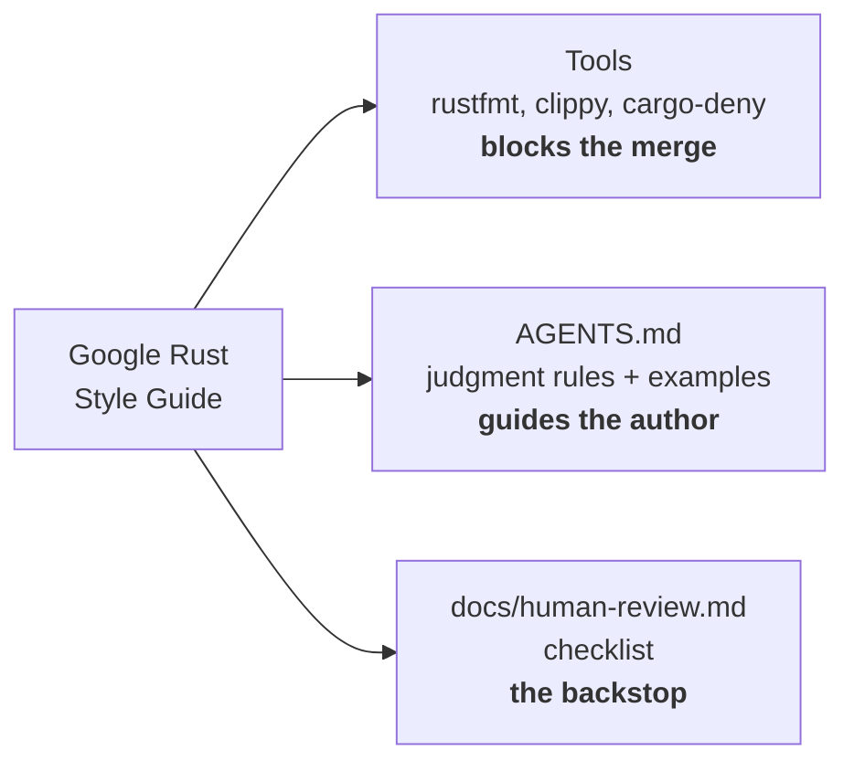

# Google Rust Style Guide: enforcement kit

[](https://github.com/DaniAkash/Google-Rust-Style-Guide/actions/workflows/ci.yml)
[](LICENSE)

Drop-in configuration that makes [Google's Rust style guide](https://google.github.io/styleguide/rustguide.html) enforceable: **rustfmt, clippy and cargo-deny** for the mechanical rules, **`AGENTS.md`** for coding agents, and a **human review guide** for everything that needs judgment.

**Website: <https://daniakash.github.io/Google-Rust-Style-Guide/>**, with a [five-minute quick start](https://daniakash.github.io/Google-Rust-Style-Guide/quick-start/), every doc, and [`llms.txt`](https://daniakash.github.io/Google-Rust-Style-Guide/llms.txt) for coding agents.

> This is an unofficial community project. It is not affiliated with, endorsed by, or maintained by Google. The style guide itself belongs to Google and is published under CC-BY 3.0; see [NOTICE](NOTICE).

## Why

The guide is roughly 70 rules. About half are mechanical enough for a linter, and the other half are design judgment: newtype or alias, iterator or `Vec`, trait or inherent `impl`. Most teams either enforce nothing or paste the guide into a prompt and hope. This kit gives each rule exactly one home:



| Layer | Rules | Examples |
|---|---|---|
| Tools | 32 of 62 in-scope rules, fully or partially | `&Vec<T>` parameters, glob imports, `unwrap`, missing `#[non_exhaustive]`, unexplained `Rc`/`Arc`, code before `main()` |
| Agents and review | the remaining 30 | Newtypes vs. aliases, iterators vs. `Vec`, error channel choice, naming, macros |
| Out of scope | 7 | Chromium and Fuchsia build-system rules |

The rule-by-rule map is in [docs/coverage.md](docs/coverage.md).

## Quick start

### Let your agent do it (recommended)

Paste this prompt into Claude Code, Codex, Cursor, Gemini CLI, GitHub Copilot or any coding agent that can run commands, from your project root:

```text
Apply the Google Rust Style Guide kit to this repository.
Follow the instructions at
https://daniakash.github.io/Google-Rust-Style-Guide/_llms-txt/for-coding-agents.txt
Then run cargo +nightly fmt, cargo clippy --workspace --all-targets -- -D warnings,
and cargo deny check bans, and fix what they report without editing the lint configuration.
```

The agent downloads the configs, turns on the lints, runs fmt, clippy and cargo-deny, and fixes your code until everything is green. Review the diff afterwards: expect new config files, lint tables in `Cargo.toml` and fixes in your code, while the lint configuration itself should match this repository's files exactly.

### Do it yourself

```sh
base=https://raw.githubusercontent.com/DaniAkash/Google-Rust-Style-Guide/main
for file in rustfmt.toml clippy.toml deny.toml rust-toolchain.toml AGENTS.md; do
  curl -fsSLO "$base/$file"
done
```

Then copy the `[workspace.lints.*]` tables from [`Cargo.toml`](Cargo.toml) into your workspace root, add `[lints] workspace = true` to each member crate, and run:

```sh
cargo +nightly fmt                                    # the guide's rustfmt options need nightly
cargo clippy --workspace --all-targets -- -D warnings
cargo deny check bans
```

Single crates, CI wiring, existing codebases and application crates are covered in [docs/adopting.md](docs/adopting.md). The [website quick start](https://daniakash.github.io/Google-Rust-Style-Guide/quick-start/) has copyable commands for each case.

## What's inside

| File | Purpose |
|---|---|
| [`Cargo.toml`](Cargo.toml) | 41 rustc, rustdoc and clippy lints, each annotated with the guide section it enforces |
| [`clippy.toml`](clippy.toml) | Thresholds, test exemptions, and disallowed `Rc`, `Arc`, `catch_unwind` and poison access |
| [`rustfmt.toml`](rustfmt.toml) | `max_width = 100` and the guide's import granularity, hex case and macro matcher options |
| [`deny.toml`](deny.toml) | Bans crates that run code before `main()` |
| [`rust-toolchain.toml`](rust-toolchain.toml) | Stable channel, since the guide forbids unstable features |
| [`AGENTS.md`](AGENTS.md) | Rules no tool can check, with examples, plus the exception policy for agents |
| [`docs/`](docs/README.md) | How it works, coverage, why, why not, human review guide, adoption |
| [`example/`](example/src) | A small library that follows the guide and passes every lint, including recorded exceptions |
| [`fixtures/`](fixtures) + [`scripts/`](scripts) | Deliberate violations that CI uses to prove every lint still fires |
| [`website/`](website) | The Astro + Starlight site, built from the files above and deployed to GitHub Pages |

## Exceptions are written down, not hidden

The guide grants exceptions to many rules. Instead of loosening a lint to accept them, the lint stays strict and the exception is recorded at the exact site, where a reviewer can judge it:

```rust
#[derive(Clone, Debug, Default)]
#[expect(
    clippy::exhaustive_structs,
    reason = "options struct; callers rely on functional record update syntax"
)]
pub struct SearchOptions {
    pub author: Option<String>,
    pub format: Option<Format>,
    pub order: SortOrder,
}
```

A bare `#[allow]` without a reason fails the build, and `#[expect]` fails once the suppression is no longer needed. [docs/human-review.md](docs/human-review.md) lists which reasons the guide accepts for each lint.

## The config tests itself

A lint configuration that quietly stops working is worse than none, because everyone believes the rules are still enforced. CI runs four checks on every push and weekly against the latest stable toolchain:

| Check | Proves |
|---|---|
| `cargo clippy -p example -- -D warnings` | Idiomatic, guide-following code passes cleanly |
| [`scripts/check-fixtures.sh`](scripts/check-fixtures.sh) | [`fixtures/violations`](fixtures/violations/src) triggers exactly the 45 lints its markers name, and nothing else |
| [`scripts/check-rustfmt.sh`](scripts/check-rustfmt.sh) | rustfmt produces exactly [`fixtures/rustfmt/expected.rs`](fixtures/rustfmt/expected.rs) |
| [`scripts/check-deny.sh`](scripts/check-deny.sh) | cargo-deny rejects a crate that depends on `ctor` |

Run them locally with the same commands. The fixture check needs `jq`, and the deny check needs [`cargo-deny`](https://github.com/EmbarkStudios/cargo-deny).

## Documentation

- [How it works](docs/how-it-works.md): the three layers, the exception workflow, and the self-tests.
- [Coverage](docs/coverage.md): every guide section and what enforces it.
- [Why](docs/why.md): the reasoning behind each lint, threshold and setting.
- [Why not](docs/why-not.md): rules that cannot be linted, known lint gaps, rejected lints, codebase-specific rules.
- [Human review guide](docs/human-review.md): what reviewers can skip, what to check in which order, and how to review agent-written code.
- [Adopting](docs/adopting.md): new projects, existing codebases, libraries vs. applications.

## Contributing

Issues and pull requests are welcome, especially when a clippy release changes lint behavior or the guide changes. A change to the lint set should come with a marked violation in `fixtures/violations`, a row update in `docs/coverage.md`, and the reasoning in `docs/why.md` or `docs/why-not.md`.

## License

Apache-2.0 for the configuration, scripts, example code and documentation in this repository. The Google Rust Style Guide is © Google, licensed under [CC-BY 3.0](https://creativecommons.org/licenses/by/3.0/). See [NOTICE](NOTICE).
