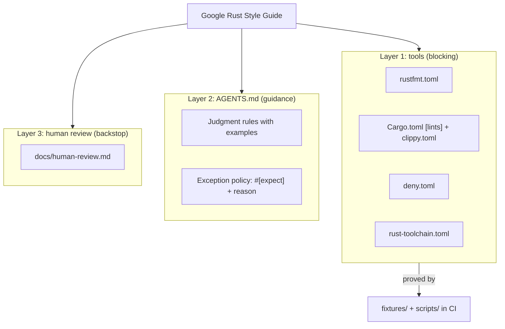
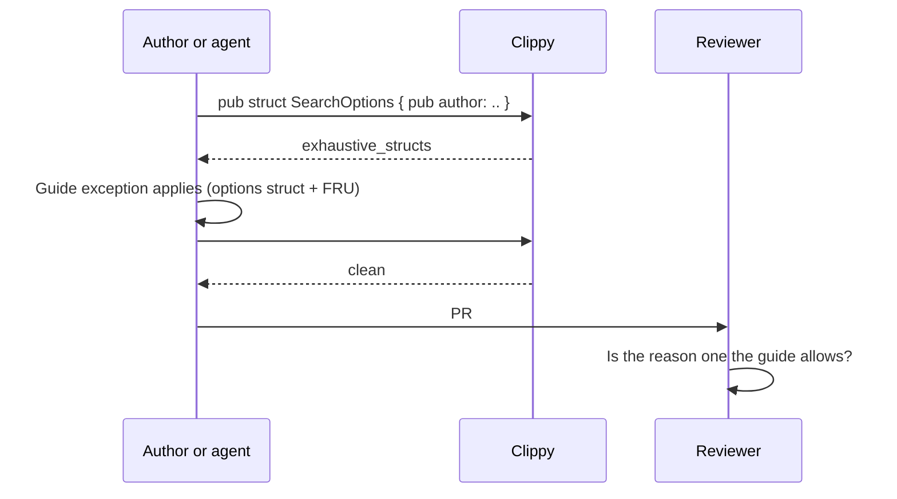

# How it works

Google's Rust style guide mixes three kinds of rules: mechanical ones (line width, `&String` parameters), semi-mechanical ones (a lint catches the common case), and design judgment (newtype or alias, iterator or `Vec`). This kit gives each kind its own layer and avoids stating a rule in more than one place.

## Layer 1: tools

| File | What it does |
|---|---|
| `rustfmt.toml` | `max_width = 100` plus the guide's three nightly-only options: `imports_granularity = "Module"`, `hex_literal_case = "Lower"`, `format_macro_matchers = true`. Stable rustfmt warns about the nightly options and skips them, so run `cargo +nightly fmt`. |
| `Cargo.toml` `[workspace.lints]` | Turns on 41 rustc, rustdoc and clippy lints, 39 at `warn` and 2 at `deny` (`unstable_features`, `invisible_characters`), each annotated with the guide section it serves. Clippy's default groups stay on through `all = { level = "warn", priority = -1 }`. |
| `clippy.toml` | Thresholds (`max-fn-params-bools = 1`, `absolute-paths-max-segments = 2`), `avoid-breaking-exported-api = false`, test exemptions, and the `disallowed-types` / `disallowed-methods` lists for `Rc`, `Arc`, `catch_unwind` and poison access. |
| `deny.toml` | Bans crates that run code before `main()`: `ctor`, `inventory`, `static_init`. |
| `rust-toolchain.toml` | Pins the stable channel, because the guide forbids unstable features. |

In CI, run clippy with `-D warnings` so every `warn` blocks a merge. Locally, warnings stay warnings so you can keep working while you fix them.

## Layer 2: AGENTS.md

[`AGENTS.md`](../AGENTS.md) is read automatically by most coding agents (Codex, Cursor, Gemini CLI, Jules, Copilot; for Claude Code, symlink it as `CLAUDE.md`). It contains:

- the commands to run before finishing,
- the exception policy (fix first, otherwise `#[expect(lint, reason = "...")]` at the narrowest scope, never edit the config),
- the guide's judgment rules, each with the short bad and good example an agent can pattern-match.

It deliberately leaves out rules the tools enforce. Restating them would spend the agent's context on things clippy already catches, and the two copies would drift apart.

## Layer 3: human review

[`human-review.md`](human-review.md) is a checklist for the reviewer. It starts from the assumption that CI is green, so formatting and lint-level issues are already handled, and focuses the reviewer on API shape, ownership design, exception reasons and the rules nothing else catches.

## The exception workflow

The guide grants exceptions to many of its rules: options structs may stay exhaustive, two-state enums may skip `#[non_exhaustive]`, `Rc` is fine when the alternative is unreasonably complex. A lint cannot evaluate those, so the kit turns each exception into something a reviewer can evaluate:

`clippy::allow_attributes_without_reason` rejects a bare `#[allow]`. `#[expect]` is preferred over `#[allow]` because it fails once the lint stops firing, so stale suppressions do not pile up.

## Proving the configuration

A lint config that silently stops working is worse than none, because everyone believes the rules are still enforced. The repository therefore tests its own configuration:

| Check | Proves |
|---|---|
| `cargo clippy -p example -- -D warnings` | Idiomatic, guide-following code passes. The configuration is strict but not hostile. |
| `scripts/check-fixtures.sh` | `fixtures/violations` triggers exactly the lints its `//~` markers name: no marked lint is silent and no unmarked lint fires. |
| `scripts/check-rustfmt.sh` | `fixtures/rustfmt/input.rs` formats to exactly `expected.rs` under nightly rustfmt. |
| `scripts/check-deny.sh` | The workspace passes cargo-deny and `fixtures/deny`, which depends on `ctor`, is rejected. |

CI also runs every Monday. When a new stable clippy renames a lint, changes what it catches, or adds a default lint that fires on the fixture, the weekly run fails before adopters notice.

## Library vs. application code

The guide's API rules are binding for library code and strong recommendations for application code. The lint configuration does not try to tell the two apart. Application crates that find an API lint (`must_use_candidate`, `exhaustive_*`, `needless_pass_by_value`) too strict can relax it in their own `[lints]` table with a comment, which keeps that decision visible. See [adopting.md](adopting.md#application-crates).
